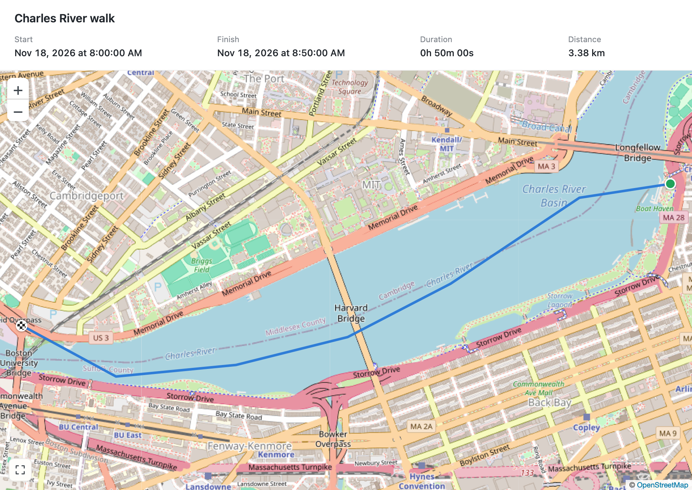

# GPX QuickLook

A macOS 13+ app and Finder Quick Look extension for GPX tracks and routes.

## Install the release (no Xcode required)

Requires **macOS 13 or later**, on Apple silicon or Intel.

1. Download **GPX-QuickLook-1.6-macOS-universal.dmg** from the [latest release](https://github.com/brianalewine/GPX-QuickLook/releases/latest). The GitHub “Source code” archives do not contain the built app.
2. Open the DMG and drag **GPX QuickLook.app** onto the **Applications** shortcut, then eject the disk image.
3. Open the app from Applications once to register its Quick Look extension.
4. Select a `.gpx` file in Finder and press **Space**.

The release is ad-hoc signed, but is **not Developer ID signed or notarized by Apple**. If macOS blocks the first launch because it cannot verify the developer, first try opening the app, then go to **System Settings → Privacy & Security → Open Anyway** and confirm. Only approve the app if you trust its source. See [Apple's first-open instructions](https://support.apple.com/en-us/102445).

If Finder does not show the preview, enable **GPXPreview** in **System Settings → General → Login Items & Extensions → Quick Look**. On older macOS versions, search System Settings for **Extensions** and look under **Quick Look**. Close and reopen the Finder preview afterward; if the extension still does not appear, log out and back in.

To update, quit the app, replace the copy in Applications, and open the new copy once.

## Build from source

Install Xcode, then run `./scripts/build.sh` and open `build/Build/Products/Release/GPX QuickLook.app`. For permanent installation, drag the app to Applications and open it once.

The app is standalone: its Quick Look extension is included inside the app bundle. No separate installer or dependencies are required.

To produce the universal release DMG and SHA-256 checksum, run `./scripts/release.sh`. Output is written to `build/release/`.

## Use

The app can also open GPX files directly with Command-O or Finder's Open With menu.

- Uses OpenStreetMap as the map base
- Pan and zoom controls
- Minimap for long trails
- Lightweight: GPX data stays on your Mac, and only currently visible map tiles are fetched as you browse.
